<!-- ═══ 01 — header ═══ -->

  

<!-- ═══ 02 — about ═══ -->

> Computer Science student who mostly uses code to make things work for me: automating repetitive tasks, building small tools that solve real problems and taking systems apart to see how they behave.
>
> Most of my time goes into cybersecurity labs, Linux environments and experiments with local AI — and into writing down what I learn along the way.

 

<!-- ═══ 03 — areas of interest ═══ -->


 

<!-- ═══ 04 — tech stack ═══ -->


 

<!-- ═══ 04b — linux ranking (edit DISTROS / RADAR in scripts/gen_assets.py) ═══ -->


 

<!-- ═══ 05 — featured projects ═══ -->

  <a href="https://github.com/demianscult/intelligent-tool-agent"></a>
  <a href="https://github.com/demianscult/tryhackme-grand-larceny-auto"></a>

  <a href="https://github.com/demianscult/rag-knowledge-assistant"></a>
  <a href="https://github.com/demianscult/llm-evaluation-lab"></a>

 

<!-- ═══ 06 — cybersecurity lab ═══ -->

| room | platform | focus | log |
|:--|:--|:--|:--|
| Grand Larceny Auto | TryHackMe | reverse engineering · .NET / CIL | [write-up ↗](https://github.com/demianscult/tryhackme-grand-larceny-auto/tree/main/grand-larceny-auto) |
| Grand Larceny Auto II | TryHackMe | API security · parameter tampering | [write-up ↗](https://github.com/demianscult/tryhackme-grand-larceny-auto/tree/main/grand-larceny-auto-ii) |
<!-- new rooms go here: | room | platform | focus | [write-up ↗](link) | -->


**toolbox** — [`gerador-senhas`](https://github.com/demianscult/gerador-senhas): password generator built on Python's `secrets` module

 

<!-- ═══ 07 — currently exploring ═══ -->
<!-- to update: edit the NOW list in scripts/gen_assets.py and run `python3 scripts/gen_assets.py` -->


 

<!-- ═══ 08 — github analytics ═══ -->

  
  

  

 

<!-- ═══ 09 — connect ═══ -->

  

